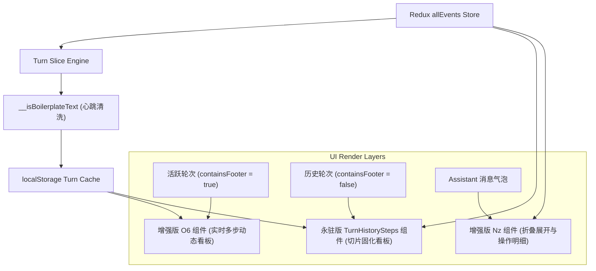

# Cue 深度解密与执行步骤常驻补丁 (Cue Deep Unveil Patch)

[](https://github.com/XEMPZ/cue-agent-patch)
[](https://github.com/XEMPZ/cue-agent-patch)
[](LICENSE)

> **为官方 Cue 桌面端（v1.1.14）打造的非侵入式热补丁**  
> 彻底解决执行步骤“一闪而过”、历史对话轮次工具调用“凭空消失”、隐藏操作参数无法查看的痛点，将后台真实执行的每一个终端命令、文件读写路径、学术检索与 MCP 调用永久固化在对话界面中。

---

## 🌟 补丁核心特性

1. **历史轮次步骤全量永驻**：彻底重构轮次容器生命周期，无论进行多少轮新对话、无论是否点击“记忆已更新”，历史各轮的工具调用记录永久保留在各自气泡下方，杜绝组件卸载清空。
2. **详细操作参数代码化透出**：不再只显示空洞的一句话，每个步骤均以代码块形式直接展示真实的终端执行命令（`terminal.command`）、读写文件绝对路径（`textEditor.path`）、检索关键词（`searchScholar.queries`）及 MCP 调用参数。
3. **套话心跳自动过滤**：智能拦截并丢弃诸如“Cue 正在处理您的请求”、“准备好接收新请求或修改”等系统占位心跳，精准捕获真正具备业务意义的思考进度。
4. **原生 UI 视觉契合**：完美适配官方明暗主题、Tailwind 设计系统与平滑滚动，带独立滚动条与收起/展开折叠卡片。
5. **双向安全一键维护**：自带备份与还原机制，每次修补前自动生成 `.bak`，支持随时无损回滚。

---

## 🚀 快速开始 (Quick Start)

### 环境要求
* 已安装 [Node.js](https://nodejs.org/) (推荐 v18 或以上版本)；
* 已安装 Cue 桌面客户端 (v1.1.14)。

### 一键安装补丁
在 Windows 环境下，克隆或下载本仓库后，直接**双击运行 `patch.bat`**，或在终端执行：
```bash
node patch.js
```

#### 自定义安装路径（可选）：
如果你的 Cue 安装在非标准目录，可通过参数显式指定：
```bash
node patch.js --asar "D:\Path\To\Cue\resources\app.asar"
# 或指定应用根目录：
node patch.js --app-path "D:\Path\To\Cue"
```

### 一键恢复官方原版
如果需要还原至未修改的官方状态，直接**双击运行 `restore.bat`**，或执行：
```bash
node restore.js
```

---

## 🧠 第一部分：Cue 软件底层工作机制全景剖析

### 1. 系统拓扑与进程划分
Cue 是一款基于 **Electron 30+、Next.js（Standalone 静态打包）与本地 Sidecar 守护进程** 紧耦合运行的混合型 Agent 架构：
- **Electron 主进程 (`dist/main.cjs`)**：负责窗口生命周期、单实例互斥锁 (`SingleInstanceLock`)、自定义协议注册 (`cue://desktop/`) 以及与本地 SQLite 数据库的异步通信。
- **渲染进程 (`out/_next/static/chunks/`)**：基于 React 18 + Redux Toolkit 构建，采用 Webpack 分块打包。所有的对话界面、时间线流转与状态管理均运行于此。
- **持久化层 (`%APPDATA%/Cue/storage/`)**：通过本地 SQLite 存储会话索引与事件日志，核心表为 `session` 与 `session_view_event`。

### 2. `toolUsed` 与 `liveStatus` 的本质鸿沟
在 Cue 的数据生命周期中，存在两种截然不同的事件类型：

| 维度 | `toolUsed` (正式工具调用) | `liveStatus` (瞬时进度文本) |
| :--- | :--- | :--- |
| **数据本质** | 具有全局唯一 UUID 的独立事件对象 | Session 根对象上的单值字符串字段 (`session.liveStatus`) |
| **存储落地** | **100% 完整持久化** 进 SQLite `session_view_event` 表 | **0 字节落库**，纯内存与流式传输广播 |
| **参数 payload** | 包含完整终端命令、文件路径、API 请求参数 | 仅为一句纯文本描述 |
| **官方处理** | 官方前端将其视为后台隐式事件，**默认不挂载看板渲染** | 每收到新文本立即**就地覆盖**旧文本；任务结束时直接置为 `undefined` |

> [!NOTE]
> 这就是为什么许多用户误以为中间步骤“被系统删除了”：实际上工具调用一直在本地数据库中，只是官方前端未做持久化挂载；而流式进度文字则因单变量就地覆盖和任务结束置空而“一闪而过”。

---

## 🛠️ 第二部分：补丁作用机理与注入架构

本补丁通过对 Next.js 前端对话主 Chunk（`61090.13c9227a47bed052.js`）实施**精确的 AST 与组件级热重构**，实现无损增强：



### 核心注入模块解析：
1. **`common_helpers` (公共清洗与缓存中间件)**：
   - `__isBoilerplateText(text)`：正则匹配过滤“工作中”、“Cue 正在处理您的请求”等占位套话。
   - `__loadTurnLiveSteps` / `__recordTurnLiveStep`：在本地 `localStorage` 维护轮次维度的状态字典，防止流式状态被覆盖或置空。
2. **`TurnHistorySteps` (历史轮次步骤永驻组件)**：
   - 官方原代码在历史轮次直接将底部状态容器卸载（`t ? <Tn /> : null`）。
   - 补丁将其替换为 `<TurnHistorySteps turnId={e.id} turnUserMsgId={...} />`，以当前轮次提问 ID 为界，动态切片本轮全部工具操作并永久驻留。
3. **`Nz` (思考过程与执行步骤折叠抽屉)**：
   - 在 Assistant 消息正上方挂载“🛠️ 执行步骤记录”卡片，包含成功/失败胶囊标签、工具名徽章、操作描述以及 Markdown 样式的参数代码块。
4. **`O6` (实时动态多步指示器)**：
   - 突破单行限制，将当前轮次正在执行的每一步动态渲染，并带流光光晕动效。

---

## 🤖 第三部分：给 AI 的新版本自适应适配指南 (AI Migration Guide)

当 Cue 官方更新版本（如 `1.1.15` 或 `1.2.x`）导致文件名或混淆变量名发生变动时，AI Agent 可按照以下**不变语义指纹**重新定位并自动生成新补丁：

### 1. 五大不变语义指纹
即使打包工具更换了变量名，底层业务常量是固定不变的：
1. **定位对话主 Chunk**：在 `out/_next/static/chunks/` 中检索包含字符串 `"Thinking process"` 且包含 `"ignoreBoundary"` 的文件。
2. **定位 Assistant 气泡组件 (原 `Nz`)**：检索包含 `.t("Thinking process")` 的函数签名 `function <CompName>({event:<param>})`。
3. **定位实时指示器组件 (原 `O6`)**：检索包含字符串 `"shimmer-text-primary"` 的函数定义。
4. **定位轮次历史分支 (原 `To`)**：检索模式 `ignoreBoundary:!0})]}):null]},e.id`。将其中的 `:null` 替换为挂载 `<TurnHistorySteps>`。
5. **提取 Redux 选择器别名**：在 Chunk 头部通过正则捕获 `selectAllEvents` 与 `currentSessionId` 绑定的模块对象名称。

### 2. 避免崩溃的关键纪律 (Preventing `ChunkLoadError`)
* **严格语法校验**：在将修改后的 Chunk 回写前，必须使用 Node.js 的 `new vm.Script(code)` 验证抽象语法树（AST）。若存在未闭合的括号或无效转义，Webpack 在动态 `import()` 时会抛出致命的 `ChunkLoadError`。
* **原生二进制解包声明**：打包 `app.asar` 时必须附带 `--unpack "{dist/windows-worker.cjs,dist/dbCache/worker.cjs,dist/native/**}"`，否则 SQLite 原生驱动无法加载。

详细的逆向工程说明与符号自动化提取脚本请参阅 [docs/MIGRATION_GUIDE_FOR_AI.md](docs/MIGRATION_GUIDE_FOR_AI.md)。

---

## 📁 仓库结构

```text
cue-agent-patch/
├── patch.js                       # Node.js 跨平台自动化安装脚本
├── restore.js                     # 官方原厂一键还原脚本
├── patch.bat                      # Windows 用户一键修补批处理
├── restore.bat                    # Windows 用户一键还原批处理
├── core/
│   ├── injector.js                # AST 语法校验与模块热注入引擎
│   └── modules/                   # 独立解耦的增强组件源码
│       ├── common_helpers.js      # 工具函数、缓存与套话过滤器
│       ├── nz_component.js        # 消息气泡步骤抽屉组件
│       ├── o6_component.js        # 实时多步指示器组件
│       └── turn_history_component.js # 历史轮次永驻看板组件
└── docs/
    ├── ARCHITECTURE.md            # Cue 完整系统架构剖析
    ├── EVENT_MODEL.md             # toolUsed 与 liveStatus 深度对比
    └── MIGRATION_GUIDE_FOR_AI.md  # 专为 AI 设计的新版本适配维护手册
```

---

## 📄 授权许可 (License)

本项目基于 [MIT License](LICENSE) 开源发布。仅供技术研究、逆向工程学习与本地效率改进使用。
