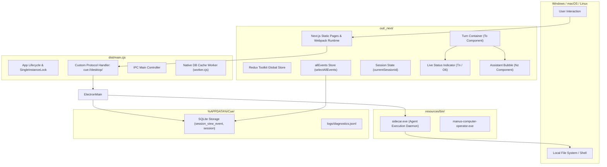

# Cue Internal System Architecture & Engineering Analysis

> **Target Application**: Cue Desktop (`Cue.exe`)  
> **Target Version**: `1.1.14` (Windows x64 / macOS / Linux)  
> **Audience**: AI Agents, Reverse Engineers, System Architects

---

## 1. High-Level Topological Overview

Cue is an AI-native agent desktop application built on top of the **Electron + Next.js (Standalone Static Export) + Node.js Worker + Native Sidecar** architecture.



---

## 2. Directory & Packaging Layout

In version `1.1.14`, Cue's core logic is packaged inside an Electron archive (`resources/app.asar`):

```text
Cue Installation Directory/
├── Cue.exe                         # Electron host executable
├── resources/
│   ├── app.asar                    # Main application bundle
│   ├── app.asar.unpacked/          # Native binaries and non-packable scripts
│   │   └── dist/
│   │       ├── windows-worker.cjs
│   │       └── dbCache/worker.cjs
│   └── bin/
│       ├── sidecar.exe             # Native sidecar daemon
│       └── manus-computer-operator.exe
└── locales/                        # Chromium localization pak files
```

### Unpacked `app.asar` Structure:
```text
app.asar/
├── package.json                    # Metadata, entry: "dist/main.cjs"
├── dist/                           # Electron Main Process bundled files
│   ├── main.cjs                    # Main process startup, window creation, protocols
│   ├── preload.cjs                 # Context bridge & IPC bindings
│   └── native/                     # SQLite native bindings (better-sqlite3)
└── out/                            # Renderer Process (Next.js Standalone Export)
    └── _next/
        └── static/
            └── chunks/             # Dynamic Webpack chunks (frontend React code)
                ├── webpack-*.js    # Webpack runtime & chunk loader
                ├── app/app/page-*.js# Root application router
                ├── 51013-*.js      # Event processing & streaming state reducer
                └── 61090.*.js      # Primary chat & timeline component tree (Target!)
```

---

## 3. Persistent Storage Engine (SQLite)

Cue uses a local SQLite database for session history and event persistence:

- **Database Directory**: `%APPDATA%\Cue\storage\` or `%USERPROFILE%\AppData\Roaming\Cue\storage\`
- **Database File**: `cache_<workspace_id>.db` or `sqlite3.db`
- **Key Tables**:
  1. `session`: Stores session metadata (`id`, `title`, `created_at`, `status`).
  2. `session_view_event`: Stores every executed event and turn item (`id`, `session_id`, `type`, `data`, `created_at`).

### The Hidden Events Truth:
When the agent executes commands (such as PowerShell commands, reading files, searching documentation), it creates events with `type: "toolUsed"`.
- Each `toolUsed` event has a permanent UUID, detail payload (`terminal.command`, `textEditor.path`, `search.queries`), and is **fully persisted in the database**.
- Official UI simply omitted the visualization drawer for historical turns, giving users the illusion that the steps vanished.

---

## 4. Frontend Rendering & Component Lifecycle

In chunk `61090.13c9227a47bed052.js`:

1. **`To` Component (Conversation Turn Container)**:
   - Evaluates `let t = !!e.containsFooter && !N;`.
   - `e.containsFooter` is `true` **ONLY** for the latest active turn where the input box is anchored.
   - For all previous historical turns, `t` evaluates to `false`.
   - Official implementation rendered: `t ? <Tn /> : null`.
   - **Result of official design**: Once a user clicked "Memory updated" or typed a new prompt, the previous turn lost its footer. React unmounted `<Tn />`, completely destroying the execution progress container for that turn!

2. **`Tn` / `O6` Component (Active Execution Indicator)**:
   - Rendered at the bottom of the active turn.
   - Officially displayed only one single line of text (`liveStatus`), which was overwritten on every progress ping and cleared on task completion.

3. **`Nz` Component (Assistant Message Bubble)**:
   - Rendered at the top of each assistant response.
   - Officially displayed only the collapsible "Thinking process" (`Z.I.t("Thinking process")`).
   - Completely lacked any execution step timeline.
