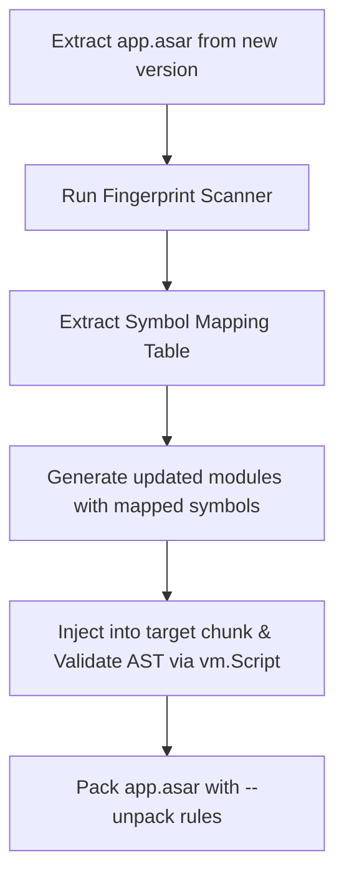

# AI Migration & Adaptation Guide: Reverse Engineering Future Cue Versions

> **Target Audience**: AI Agents (GPT, Claude, Gemini, Antigravity, etc.) and Automated Tooling  
> **Purpose**: Step-by-step instructions for an AI to adapt this patch when Cue updates to a new version (e.g., `1.1.15`, `1.2.x`, `2.x`) where chunk names and minified identifiers have changed.

---

## 1. Why Patches Break on Version Updates

Cue's renderer is bundled using Next.js / Webpack in production mode:
1. **Chunk File Names**: File names include content hashes (e.g., `61090.13c9227a47bed052.js`). On update, the hash and even the chunk ID will change.
2. **Minified Identifiers**: Function names (`Nz`, `O6`, `To`, `Tn`) and React JSX runtime references (`(0, P.jsx)`, `(0, eO.useState)`) are generated by Terser/SWC and will differ across builds.
3. **Redux Store Aliases**: Selectors like `X.sessionsSlice.selectors.currentSessionId` or `sH.M.selectors.selectAllEvents` may be bound to different imported module variable names.

However, **the business semantics, constant strings, and component hierarchy remain virtually identical**.

---

## 2. Invariable Semantic Fingerprints (The 5 Golden Anchors)

When inspecting a new version, DO NOT search for obfuscated names like `Nz` or `O6`. Instead, scan the unpacked `out/_next/static/chunks/` directory using these **invariable semantic fingerprints**:

### Fingerprint 1: Locate the Target Conversation Chunk
Run a search across all `.js` files in `out/_next/static/chunks/`:
```bash
grep -rn "Thinking process" out/_next/static/chunks/
```
* **Expected Result**: Exactly one large chunk (usually 4MB–6MB) responsible for the conversation timeline. This is your target file.

---

### Fingerprint 2: Locate the Assistant Response Component (Formerly `Nz`)
Search inside the target chunk for:
```javascript
.t("Thinking process")
```
Context will look like:
```javascript
children: [
  (0, P.jsx)("div", {
    className: (0, G.cn)("text-base overflow-hidden relative", a ? "animate-shimmer text-transparent" : "text-[var(--text-secondary)]"),
    style: a ? { background: "var(--background-thinking)", ... } : {},
    children: Z.I.t("Thinking process") // <--- ANCHOR!
  })
]
```
* **How to identify bounds**:
  - Scan backwards to find the enclosing function signature: `function <CompName>({event:<param>})` (e.g. `function Nz({event:e})`).
  - Scan forwards to the next function declaration: `function <NextComp>({` (e.g. `function NV({`).
  - The range between these two marks the exact bounds of the Assistant Message Header.

---

### Fingerprint 3: Locate the Active Status Indicator Component (Formerly `O6`)
Search inside the target chunk for:
```javascript
"shimmer-text-primary"
```
Context will look like:
```javascript
children: [
  (0, P.jsx)("span", {
    className: (0, G.cn)("shimmer-text-primary min-w-0 truncate", ...),
    children: ...
  })
]
```
* **How to identify bounds**:
  - Scan backwards to the function declaration: `function <CompName>({` (formerly `function O6({`).
  - Scan forwards to component metadata or next function: e.g., `<CompName>._id=` or `function <NextComp>`.

---

### Fingerprint 4: Locate the Turn Container & History Branch (Formerly `To`)
Search inside the target chunk for:
```javascript
ignoreBoundary:!0
```
Context will look like:
```javascript
D && B && (0, P.jsx)(Eq, { event: B, ignoreBoundary: !0 })] }) : null] }, e.id)
```
* **Notice the crucial ternary operator**:
  `: null] }, e.id`
  This is where the official code discards history turns!
  - `t ? (0,P.jsx)(Tn, ...) : null`
  - In our patch, we replace `: null` with `: (0,P.jsx)(TurnHistorySteps, { turnId: e.id, turnUserMsgId: ... })`.

---

### Fingerprint 5: Extract Redux Store & React Runtime Identifiers
In the target chunk, inspect how React hooks and Redux selectors are imported:
1. **JSX Runtime**: Look for `(0, <Var>.jsx)` or `(0, <Var>.jsxs)`. (In v1.1.14 it is `P`).
2. **React Hooks**: Look for `(0, <Var>.useState)` and `(0, <Var>.useMemo)`. (In v1.1.14 it is `eO`).
3. **Classnames Helper**: Look for `(0, <Var>.cn)`. (In v1.1.14 it is `G`).
4. **Current Session Selector**: Look for `useAppSelector` coupled with `currentSessionId`.
   - Pattern: `<Var>.useAppSelector(<StoreVar>.sessionsSlice.selectors.currentSessionId)`
5. **All Events Selector**: Look for `useAppSelector` coupled with `selectAllEvents`.
   - Pattern: `<Var>.useAppSelector(<StoreVar>.selectors.selectAllEvents)`

---

## 3. Automated Adaptation Pipeline for AI

When adapting this patch to a new version, an AI Agent should execute this 4-step pipeline:



### Automated Symbol Extractor Script (Run this in Node.js):
```javascript
// tools/extract_symbols.js
const fs = require('fs');

function extractSymbols(chunkText) {
  const symbols = {};

  // 1. Find JSX Runtime
  const jsxMatch = chunkText.match(/\(0,(\w+)\.jsx\)/);
  symbols.jsx = jsxMatch ? jsxMatch[1] : 'P';

  // 2. Find useState / useMemo
  const stateMatch = chunkText.match(/\(0,(\w+)\.useState\)/);
  symbols.reactHooks = stateMatch ? stateMatch[1] : 'eO';

  // 3. Find cn (classnames)
  const cnMatch = chunkText.match(/\(0,(\w+)\.cn\)/);
  symbols.cn = cnMatch ? cnMatch[1] : 'G';

  // 4. Find selectAllEvents
  const eventsMatch = chunkText.match(/(\w+(?:\.\w+)?)\.selectors\.selectAllEvents/);
  symbols.allEvents = eventsMatch ? eventsMatch[1] : 'sH.M';

  // 5. Find currentSessionId
  const sessionMatch = chunkText.match(/(\w+)\.sessionsSlice\.selectors\.currentSessionId/);
  symbols.sessionSlice = sessionMatch ? sessionMatch[1] : 'X';

  return symbols;
}

console.log(extractSymbols(fs.readFileSync('path/to/new/chunk.js', 'utf8')));
```

---

## 4. Critical Pitfalls & Rules to Avoid Breaking Cue

### 1. The `ChunkLoadError` Danger (Syntax / Bracket Mismatch)
- Webpack loads chunks dynamically. If a syntax error exists in your injected code (even an extra `}` or `)`), Webpack fails silently during `import()` and triggers a fatal `ChunkLoadError at p.f.j`.
- **Golden Rule**: **NEVER** save the chunk without verifying it with:
  ```javascript
  new vm.Script(code); // Throws immediately if AST syntax is invalid
  ```

### 2. The Native SQLite Unpack Requirement
Cue uses native Node.js addons (`better-sqlite3` and Windows worker binaries). If you repack `app.asar` without unpacking native binaries, Cue will crash on boot with `Module did not self-register`:
- **Always specify `--unpack` flags**:
  ```bash
  npx --yes @electron/asar pack "<srcDir>" "<destAsar>" --unpack "{dist/windows-worker.cjs,dist/dbCache/worker.cjs,dist/native/**}"
  ```

### 3. Template Literal String Interpolation in Scripts
If you generate JavaScript code inside another JavaScript string, `${variable}` will be evaluated at script generation time instead of runtime!
- **Solution**: Always store raw component code in standalone files (`core/modules/*.js`) and read them via `fs.readFileSync`. Do not write multi-megabyte template strings inside JavaScript files.
